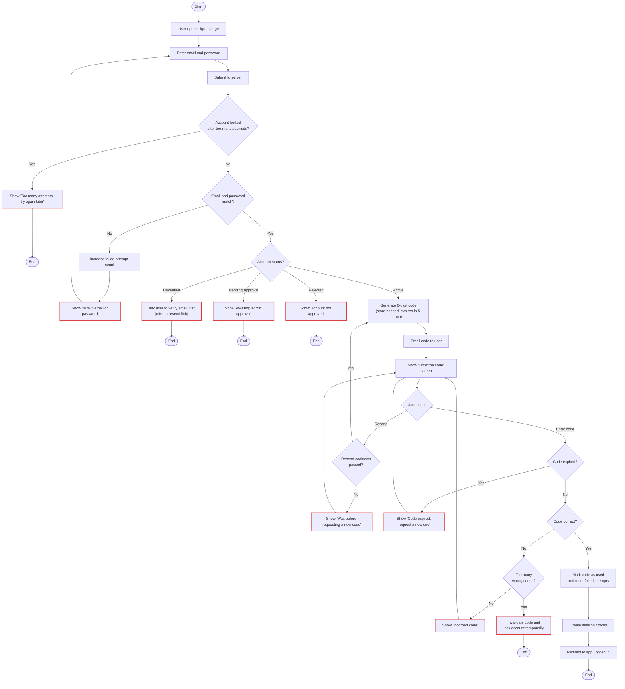

# Sign-in flow

The user signs in with email and password, then confirms with a one-time code (OTP) sent to their email. Only accounts that are verified and approved by an admin (see [sign-up flow](signup-flow.md)) can sign in.

